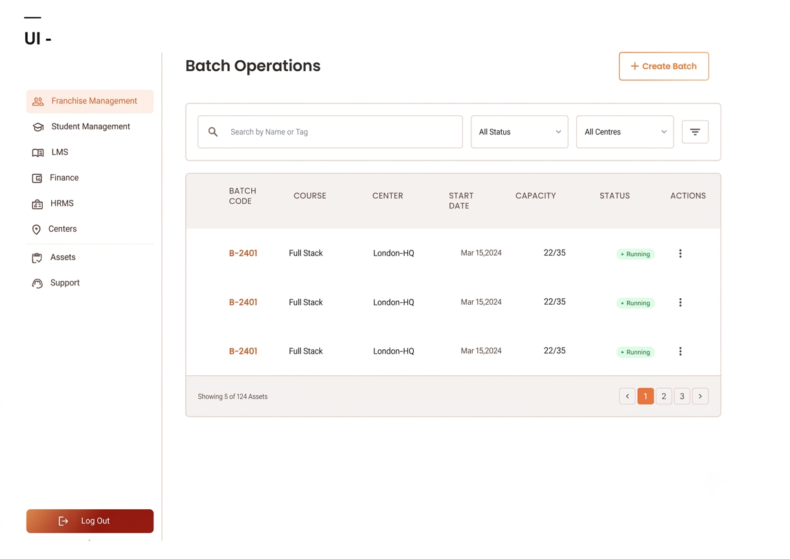

[](https://github.com/Bharath-Kumar-Chaduvula/Batch-Operations-UI)

# Batch Operations UI

A web-based Batch Operations Management System designed to manage training batches across different training centres.

The application provides an interface for creating, viewing, searching, filtering, sorting, and monitoring training batches.

## Project Overview

**Project Name:** Batch Operations UI

**Version:** 1.0.0

**Project Type:** Full-Stack Web Application

**Project Status:** Development

## Key Features

- Batch search functionality.
- Filter batches by status and centre.
- Pagination for batch records.
- Enrolment capacity monitoring.

## Technology Stack

### Frontend

- React
- JavaScript
- JSX
- CSS / Tailwind CSS (as implemented)

### Backend

- JavaScript
- Node.js (if used as the runtime)

## Project Architecture

The project follows a separated frontend and backend structure.

```text
                 User
                   |
                   v
             Frontend (React)
                   |
                   v
             Backend API
                   |
          +--------+--------+
          |                 |
          v                 v
      Controllers         Routes
          |                 |
          +--------+--------+
                   |
                   v
               Data Layer
```

## Project Structure

```text
project/
│
├── backend/
│   ├── controllers/
│   ├── data/
│   │   └── batches.js
│   ├── routes/
│   ├── app.js
│   └── server.js
│
├── frontend/
│   └── src/
│       ├── components/
│       ├── pages/
│       ├── services/
│       ├── App.jsx
│       └── main.jsx
│
├── README.md
└── .gitignore
```

## Application Modules

### Frontend

Responsible for the user interface and user interactions.

- **Components:** Reusable UI elements.
- **Pages:** Application screens.
- **Services:** API communication and frontend service logic.
- **App.jsx:** Main application component.
- **main.jsx:** Application entry point.

### Backend

Responsible for handling application logic and data operations.

- **Controllers:** Request-handling logic.
- **Routes:** API endpoint definitions.
- **Data:** Batch-related data.
- **app.js:** Backend application configuration.
- **server.js:** Backend server entry point.

## Getting Started

### Clone the Repository

```bash
git clone <repository-url>
```

### Frontend

```bash
cd frontend
npm install
npm run dev
```

### Backend

```bash
cd backend
npm install
npm start
```

The actual commands depend on the scripts configured in each `package.json`.

### Vercel Deployment

Deploy the `frontend` directory as a Vite project in Vercel. Set this environment
variable in the Vercel project settings to the public URL of your deployed backend:

```text
VITE_API_BASE_URL=https://your-backend-url.example.com
```

Redeploy after adding or changing the variable. Local development uses
`http://localhost:5000` automatically when this variable is not set.

## Documentation

- [Software Requirements Specification (SRS)](docs/software-requirements-specification.md)

## Future Enhancements

- Database integration.
- Backend API integration.
- Authentication and authorization.
- Batch editing functionality.
- Student management.
- Data export functionality.

## License

For educational and assignment purposes.
