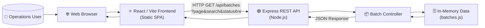
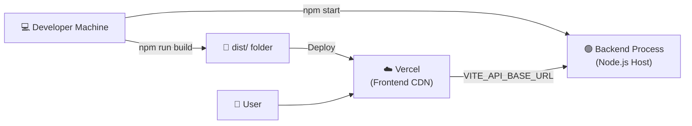

# High-Level Design (HLD)

## Batch Operations UI

**Prepared by:** Bharath Kumar Chaduvula
**Version:** 1.0
**Date:** 2026-11-05
**Document Status:** Final

---

## 1. Introduction

### 1.1 Purpose

This High-Level Design (HLD) document describes the overall system architecture, major components, their responsibilities, and the interactions between them for the **Batch Operations UI** system. It is intended for architects, developers, and technical reviewers.

### 1.2 Scope

This document covers the architecture for version 1.0, including the React frontend, Node.js/Express backend, and in-memory data layer.

---

## 2. System Overview

The Batch Operations UI is a **two-tier web application**:

- **Tier 1 — Presentation Layer:** A React single-page application (SPA) built with Vite, served as static files.
- **Tier 2 — Application/API Layer:** A Node.js Express REST API serving batch data with filtering, search, and pagination.

There is currently **no Tier 3 (database)**; data is stored in an in-memory JavaScript array. This is a known limitation planned for a future increment.

---

## 3. Architecture Diagram



---

## 4. Technology Stack

| Layer | Technology | Version | Purpose |
|---|---|---|---|
| Frontend | React | 19 | UI component framework |
| Frontend | JSX | — | Component syntax |
| Frontend | Tailwind CSS | 4 | Utility-first styling |
| Frontend | Lucide React | Latest | Icon library |
| Frontend | Axios | Latest | HTTP client |
| Build Tool | Vite | Latest | Dev server and bundler |
| Backend | Node.js | LTS | JavaScript runtime |
| Backend | Express | 5 | REST API framework |
| Backend | CORS middleware | Latest | Cross-origin request handling |
| Data | JavaScript Array | — | In-memory data store |
| Deployment | Vercel | — | Frontend hosting |
| Deployment | Node.js Host | — | Backend hosting |

---

## 5. Major Components

### 5.1 Frontend SPA

The frontend is a React SPA bootstrapped with Vite. It is composed of:

| Component | Role |
|---|---|
| `main.jsx` | Application entry point; mounts React into the DOM |
| `App.jsx` | Root layout; renders Sidebar and BatchOperationsPage side by side |
| `Sidebar.jsx` | Fixed left navigation panel with branding and nav links |
| `BatchOperationsPage.jsx` | Page-level state manager; orchestrates data fetching |
| `FilterBar.jsx` | Search input and filter dropdowns |
| `BatchTable.jsx` | Data table with status badges and display states |
| `PaginationFooter.jsx` | Page navigation controls and record count |
| `batchService.js` | Axios-based API client abstraction |

### 5.2 Backend REST API

The backend is a Node.js Express application:

| Module | Role |
|---|---|
| `server.js` | Starts the HTTP listener on port 5000 |
| `app.js` | Express application; wires middleware and routes |
| `batchRoutes.js` | Defines `GET /api/batches` route |
| `batchController.js` | Business logic: validates, filters, paginates, responds |
| `batches.js` | Static in-memory batch data array (12 records) |

---

## 6. Data Flow

### 6.1 Standard Request Flow

```
User interacts with FilterBar or PaginationFooter
        ↓
BatchOperationsPage state updates (search, status, centre, page)
        ↓
useEffect triggers → batchService.fetchBatches() called
        ↓
Axios sends GET /api/batches?page=X&search=Y&status=Z&centre=W
        ↓
Express Router → batchController.getBatches()
        ↓
Controller: validates → filters array → paginates → builds JSON
        ↓
JSON response returned to Axios
        ↓
BatchOperationsPage: updates batches + pagination state
        ↓
BatchTable and PaginationFooter re-render with new data
```

### 6.2 Error Flow

```
Axios request fails (network/server error)
        ↓
.catch() handler sets error state message
        ↓
BatchTable renders error message + Retry button
        ↓
User clicks Retry → retryKey incremented → useEffect re-runs
        ↓
New API request sent
```

---

## 7. Interface Design

### 7.1 Frontend–Backend Interface

| Attribute | Value |
|---|---|
| Protocol | HTTP/1.1 |
| Method | GET |
| Endpoint | `/api/batches` |
| Format | JSON |
| Auth | None (v1.0) |
| CORS | Enabled (all origins) |

### 7.2 URL Configuration

The API base URL is configured via the `VITE_API_BASE_URL` environment variable:

| Environment | Base URL |
|---|---|
| Development | `http://localhost:5000` (auto-fallback) |
| Production | Configured via `VITE_API_BASE_URL` env var |
| Same-origin | Empty string (no prefix) |

---

## 8. Deployment Architecture



---

## 9. Security Considerations (v1.0)

| Concern | Current Status |
|---|---|
| Authentication | Not implemented |
| Authorization | Not implemented |
| CORS | Enabled for all origins (open) |
| Rate Limiting | Not implemented |
| Input Sanitisation | Query parameters validated in controller |
| HTTPS | Depends on hosting provider configuration |
| Security Headers | Not configured |

> [!WARNING]
> The current CORS configuration allows all origins. Before moving to production with real data, CORS origins must be restricted and authentication must be added.

---

## 10. Scalability Considerations

| Factor | Current State | Future Path |
|---|---|---|
| Data Volume | 12 records (in-memory) | Replace with database query |
| Concurrent Users | Single-process Node.js | Cluster mode or container orchestration |
| Search Performance | O(n) linear scan | Database indexes |
| Frontend Hosting | Vercel CDN | Already scalable |
| API Hosting | Single instance | Load balancer + multiple instances |

---

## 11. Known Limitations

1. **No persistence** — All data is lost on server restart.
2. **In-memory filtering** — Scales only to small datasets.
3. **No authentication** — Any user with the URL can access the API.
4. **Static centre list** — Centres are hardcoded in the frontend dropdown.
5. **Desktop-first UI** — Mobile sidebar not collapsible.

---

*This document is prepared for educational and assignment purposes.*

