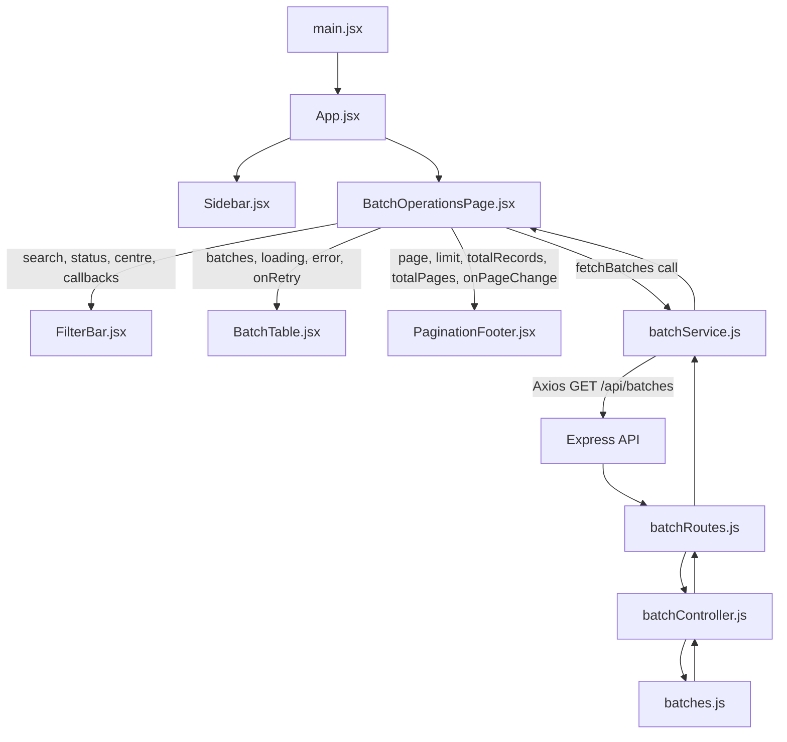
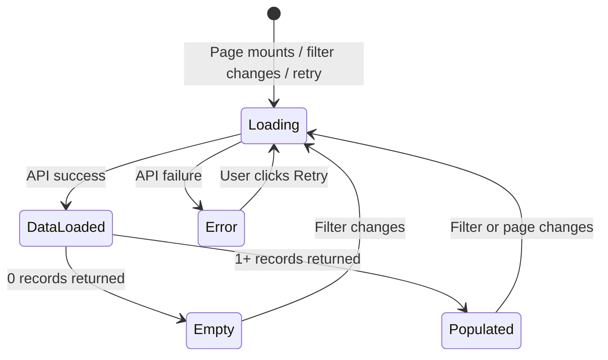

# Low-Level Design (LLD)

## Batch Operations UI

**Prepared by:** Bharath Kumar Chaduvula
**Version:** 1.0
**Date:** 2026-11-05
**Document Status:** Final

---

## 1. Introduction

This Low-Level Design (LLD) document provides detailed, implementation-level specifications for every module in the **Batch Operations UI** system. It describes data structures, function signatures, component state, props, algorithms, and module-level interactions.

---

## 2. Frontend — Detailed Design

### 2.1 `main.jsx` — Application Entry Point

**Responsibility:** Mount the React application into the HTML DOM.

```jsx
// Renders <App /> into the #root element
ReactDOM.createRoot(document.getElementById('root')).render(
  <StrictMode>
    <App />
  </StrictMode>
)
```

- Wraps the app in `React.StrictMode` for development warnings.
- No props or state.

---

### 2.2 `App.jsx` — Root Layout Component

**Responsibility:** Compose the top-level page layout.

```jsx
function App() {
  return (
    <div className="flex min-h-screen bg-[#faf8f5]">
      <Sidebar />
      <BatchOperationsPage />
    </div>
  )
}
```

**Layout:** Flexbox row. Sidebar is fixed-width (`w-64`); `BatchOperationsPage` is `flex-1`.

**Props:** None
**State:** None
**Children:** `Sidebar`, `BatchOperationsPage`

---

### 2.3 `Sidebar.jsx` — Navigation Sidebar

**Responsibility:** Display brand identity and navigation links.

**Props:** None
**State:** None

**Data Structure — Navigation Items:**
```js
const primaryItems = [
  ['Franchise Management', Building2, true],  // [label, IconComponent, isActive]
  ['Student Management', GraduationCap],
  ['LMS', LayoutDashboard],
  ['Finance', CircleDollarSign],
  ['HRMS', Users],
  ['Centers', BarChart3],
]
```

**Render Logic:**
- Maps `primaryItems` → renders each as a `<div>` with icon + label.
- If `isActive` is `true`, applies active styles (`bg-[#fff0e8] text-[#e76638]`).
- Renders Assets and Support separately after a `<hr>` divider.
- Renders Log Out button at bottom using `mt-auto`.

---

### 2.4 `BatchOperationsPage.jsx` — Page State Manager

**Responsibility:** Own all page state, orchestrate data fetching, pass data to child components.

**Props:** None

**State:**

| State Variable | Type | Initial Value | Description |
|---|---|---|---|
| `batches` | `Array` | `[]` | Current page of batch records |
| `pagination` | `Object` | `{page:1, limit:5, totalRecords:0, totalPages:0}` | Pagination metadata |
| `search` | `string` | `''` | Current search term |
| `status` | `string` | `''` | Selected status filter |
| `centre` | `string` | `''` | Selected centre filter |
| `page` | `number` | `1` | Current page number |
| `loading` | `boolean` | `true` | Whether a request is in flight |
| `error` | `string` | `''` | Error message, or empty if none |
| `retryKey` | `number` | `0` | Incremented to force a retry |

**Constants:**
```js
const PAGE_SIZE = 5
```

**Data Fetching — useEffect Algorithm:**
```
1. Set active = true (cleanup flag)
2. Set loading = true, error = ''
3. Call fetchBatches({ page, limit:PAGE_SIZE, search, status, centre })
4. On success: if active → setBatches(result.data), setPagination(result.pagination)
5. On error: if active → setError('Unable to load batches...')
6. On finally: if active → setLoading(false)
7. Return cleanup: () => { active = false }

Dependencies: [page, search, status, centre, retryKey]
```

**Filter Update Helper:**
```js
const updateFilter = (setter) => (value) => {
  setter(value)
  setPage(1)   // Always reset to page 1 on filter change
}
```

**Props passed to children:**

| Child | Props |
|---|---|
| `FilterBar` | `search, status, centre, onSearch, onStatus, onCentre` |
| `BatchTable` | `batches, loading, error, onRetry` |
| `PaginationFooter` | `...pagination, page, onPageChange` |

---

### 2.5 `FilterBar.jsx` — Search and Filter Controls

**Responsibility:** Render search input and filter dropdowns; call parent callbacks on change.

**Props:**

| Prop | Type | Description |
|---|---|---|
| `search` | `string` | Current search value |
| `status` | `string` | Current status filter |
| `centre` | `string` | Current centre filter |
| `onSearch` | `function` | Called with new search string |
| `onStatus` | `function` | Called with new status string |
| `onCentre` | `function` | Called with new centre string |

**Static Data:**
```js
const centres = ['Bengaluru', 'Chennai', 'Delhi', 'Hyderabad', 'Kochi', 'Mumbai', 'Pune']
```

**Render Structure:**
```
<div> (flex row, card container)
  ├── Search input (with lucide Search icon on left)
  ├── Status <select> (All Status | Running | Upcoming | Completed)
  ├── Centre <select> (All Centres | ...centres)
  └── Filter icon button (placeholder)
```

---

### 2.6 `BatchTable.jsx` — Data Table

**Responsibility:** Render batch data rows or appropriate display states.

**Props:**

| Prop | Type | Description |
|---|---|---|
| `batches` | `Array<Batch>` | Records to render |
| `loading` | `boolean` | Show loading spinner if true |
| `error` | `string` | Show error state if truthy |
| `onRetry` | `function` | Called when Retry is clicked |

**Helper Functions:**

```js
function formatDate(value) {
  // Parses 'YYYY-MM-DD' as local date and formats to 'Mon DD, YYYY'
  return new Date(`${value}T00:00:00`).toLocaleDateString('en-US', {
    month: 'short', day: 'numeric', year: 'numeric'
  })
}

function statusStyle(status) {
  // Returns Tailwind classes for the status badge
  return {
    Running:   'bg-[#eaf7ed] text-[#3f9560] before:bg-[#42a967]',
    Upcoming:  'bg-[#fff5dd] text-[#bd8429] before:bg-[#e3a72d]',
    Completed: 'bg-[#f0f1f2] text-[#7b8085] before:bg-[#92979c]',
  }[status] || 'bg-gray-100 text-gray-500 before:bg-gray-400'
}
```

**Render Logic (priority order):**

```
if loading       → show spinner row (colSpan=7)
else if error    → show error message + Retry button (colSpan=7)
else if empty    → show "No batches match..." message (colSpan=7)
else             → map batches → render <tr> per batch
```

**Table Columns:** `Batch Code | Course | Center | Start Date | Capacity | Status | Actions`

---

### 2.7 `PaginationFooter.jsx` — Pagination Controls

**Responsibility:** Display pagination summary and page navigation buttons.

**Props:**

| Prop | Type | Description |
|---|---|---|
| `page` | `number` | Current page number |
| `limit` | `number` | Records per page |
| `totalRecords` | `number` | Total matching records |
| `totalPages` | `number` | Total number of pages |
| `onPageChange` | `function` | Called with new page number |

**Computed Values:**
```js
const first = totalRecords === 0 ? 0 : (page - 1) * limit + 1
const last  = Math.min(page * limit, totalRecords)
// Display: "Showing {first}–{last} of {totalRecords} Batches"
```

**Button States:**
- Previous (`ChevronLeft`): disabled when `page === 1`
- Next (`ChevronRight`): disabled when `page >= totalPages || totalPages === 0`
- Page numbers: rendered for each index from 1 to `totalPages`; active page gets orange fill.

---

### 2.8 `batchService.js` — API Client

**Responsibility:** Encapsulate the Axios HTTP client and expose a typed fetch function.

**Configuration:**
```js
const apiBaseUrl =
  import.meta.env.VITE_API_BASE_URL ||
  (import.meta.env.DEV ? 'http://localhost:5000' : '')

const api = axios.create({ baseURL: apiBaseUrl })
```

**Function:**
```js
async function fetchBatches({
  page   = 1,
  limit  = 5,
  search = '',
  status = '',
  centre = '',
} = {}) {
  const response = await api.get('/api/batches', {
    params: { page, limit, search, status, centre },
  })
  return response.data  // { success, data, pagination }
}
```

---

## 3. Backend — Detailed Design

### 3.1 `server.js` — HTTP Listener

```js
const port = Number.parseInt(process.env.PORT || '5000', 10)
app.listen(port, () => {
  console.log(`Batch Operations API listening on http://localhost:${port}`)
})
```

- Reads `PORT` from environment; defaults to `5000`.
- No other logic; delegates all application concerns to `app.js`.

---

### 3.2 `app.js` — Express Application

**Middleware chain:**
```
Request
  → cors()           (enable cross-origin)
  → express.json()   (parse JSON bodies)
  → GET /            (health check)
  → /api/batches     (batch router)
```

---

### 3.3 `batchRoutes.js` — Route Definition

```js
router.get('/', getBatches)
// Maps GET /api/batches → batchController.getBatches
```

---

### 3.4 `batchController.js` — Business Logic

**Function:** `getBatches(req, res)`

**Input Parsing:**
```js
const { search = '', status = '', centre = '' } = req.query
const page  = Number.parseInt(req.query.page  || '1', 10)
const limit = Number.parseInt(req.query.limit || '5', 10)
```

**Validation Algorithm:**
```
if page < 1 OR not integer    → 400 { error: "page must be at least 1 and limit must be between 1 and 100" }
if limit < 1 OR limit > 100   → 400 (same message)
if status is non-empty AND not in allowedStatuses → 400 { error: "status must be one of: Running, Upcoming, Completed" }
```

**Filter Algorithm:**
```
normalizedSearch = search.trim().toLowerCase()
normalizedCentre = centre.trim().toLowerCase()

filtered = batches.filter(batch =>
  matchesSearch: !normalizedSearch OR
                 batch.batchCode.toLowerCase().includes(normalizedSearch) OR
                 batch.course.toLowerCase().includes(normalizedSearch)
  AND
  matchesStatus: !status OR batch.status === status   (exact match)
  AND
  matchesCentre: !normalizedCentre OR
                 batch.centre.toLowerCase() === normalizedCentre  (exact case-insensitive)
)
```

**Pagination Algorithm:**
```
totalRecords = filtered.length
start        = (page - 1) * limit
items        = filtered.slice(start, start + limit)
totalPages   = Math.ceil(totalRecords / limit)
```

**Response Shape:**
```json
{
  "success": true,
  "data": [ ...items ],
  "pagination": {
    "page": 1,
    "limit": 5,
    "totalRecords": 12,
    "totalPages": 3
  }
}
```

---

### 3.5 `batches.js` — Data Layer

**Data Structure:**
```ts
type Batch = {
  batchCode:   string   // e.g. "BAT-2026-001"
  course:      string   // e.g. "Full Stack Web Development"
  centre:      string   // e.g. "Bengaluru"
  startDate:   string   // ISO date, e.g. "2026-01-12"
  enrolled:    number   // Current enrolment count
  maxCapacity: number   // Maximum allowed enrolment
  status:      "Running" | "Upcoming" | "Completed"
}
```

**Record Count:** 12 records

**Centres represented:** Bengaluru (×2), Hyderabad (×2), Chennai (×2), Pune (×2), Mumbai (×2), Delhi (×1), Kochi (×1)

**Status distribution:**
- Completed: 2
- Running: 3
- Upcoming: 7

---

## 4. Component Interaction Diagram



---

## 5. State Transition Diagram



---

*This document is prepared for educational and assignment purposes.*

