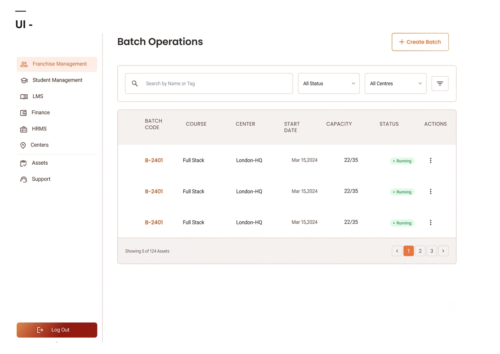
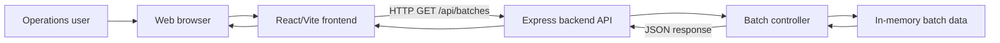
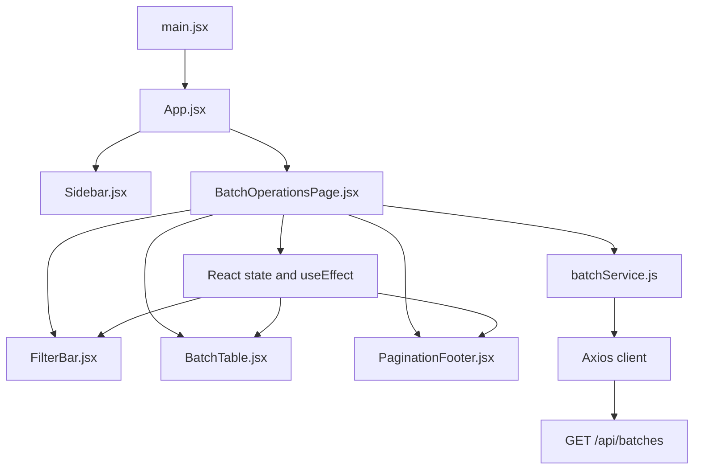
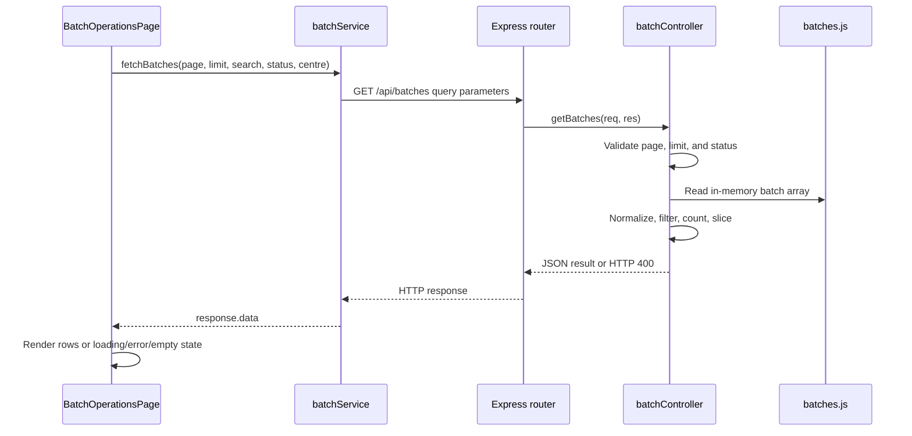

# Software Requirements Specification

## Batch Operations UI

**Version:** 1.0  
**Document status:** As-built specification  
**Product status:** Development  
**Last updated:** 2026-11-05

## 1. Purpose

This document describes the Batch Operations UI as it is currently implemented. It
covers the user interface, API, data flow, architecture, requirements, and known
limitations. It is an as-built reference, not a specification of features that
are not yet present.

## 2. Scope

The application provides a web interface for viewing training batches across
training centres. The current build supports:

- Viewing batches in a responsive table.
- Searching by batch code or course.
- Filtering by status and centre.
- Server-side pagination.
- Displaying enrolment capacity and batch status.
- Loading, empty, API-error, and retry states.

The current build does **not** persist data or implement batch creation,
editing, deletion, authentication, authorization, or batch action menus.

## 3. Users and primary use case

The primary user is an operations staff member who needs to monitor training
batches, locate a specific batch, and review its centre, start date, capacity,
and status.

### Main use case: Monitor batches

1. The user opens the Batch Operations page.
2. The frontend requests the first page of batches from the backend.
3. The user optionally enters a batch-code/course search term or selects a
   status/centre.
4. The frontend resets to page 1 and requests the filtered result set.
5. The user navigates between result pages.
6. The table displays the matching batches and pagination summary.

## 4. Current product design

The current visual design is a desktop-first operations dashboard:

- A fixed white left sidebar provides the Batchly branding and navigation
  placeholders for Franchise Management, Student Management, LMS, Finance,
  HRMS, Centers, Assets, and Support.
- The main content area uses a warm off-white background and an orange accent.
- The active navigation item is Franchise Management.
- The page header contains the `Batch Operations` title and a visual
  `Create Batch` button.
- A filter card contains search, status, centre, and filter-options controls.
- A bordered table card contains batch data, status badges, and an action icon.
- A pagination footer shows the displayed range and page controls.
- The table is horizontally scrollable below its minimum width; the main layout
  uses flex wrapping for smaller viewports.



## 5. High-level architecture

The system is split into a browser-rendered React frontend and a Node.js
Express backend. The backend currently reads from an in-memory JavaScript
array; there is no database or external service.



### Runtime boundaries

| Boundary | Current implementation |
|---|---|
| Browser UI | React 19, JSX, Tailwind CSS 4, Lucide icons |
| Frontend build/dev server | Vite |
| Frontend HTTP client | Axios |
| Backend runtime | Node.js |
| Backend framework | Express 5 |
| Cross-origin support | Express CORS middleware |
| Persistence | In-memory `batches` array |
| Default API port | `5000` |

## 6. Low-level architecture

### 6.1 Frontend component architecture



`BatchOperationsPage` owns the page state:

- `batches`: current page of rows.
- `pagination`: page, limit, total records, and total pages.
- `search`, `status`, and `centre`: active filters.
- `page`: current page number.
- `loading` and `error`: request state.
- `retryKey`: causes a request retry.

Changing a filter resets the page to 1. A request cleanup flag prevents an old
request from updating state after the page has unmounted or a newer request has
completed.

### 6.2 Backend request architecture



### 6.3 Backend module responsibilities

| Module | Responsibility |
|---|---|
| `backend/server.js` | Reads `PORT`, starts the HTTP listener, defaults to port 5000 |
| `backend/app.js` | Creates Express app, enables CORS/JSON parsing, mounts routes, exposes health response |
| `backend/routes/batchRoutes.js` | Maps `GET /api/batches` to the controller |
| `backend/controllers/batchController.js` | Validates query parameters, filters records, paginates, and shapes JSON |
| `backend/data/batches.js` | Supplies the current 12 sample batch records |

## 7. Functional requirements

The status column describes the current implementation.

| ID | Requirement | Status |
|---|---|---|
| FR-01 | The system shall display the Batch Operations page with navigation, header, filters, table, and pagination. | Implemented |
| FR-02 | The system shall load batch data from the backend when the page loads. | Implemented |
| FR-03 | The user shall be able to search by batch code or course using case-insensitive partial matching. | Implemented |
| FR-04 | The user shall be able to filter by `Running`, `Upcoming`, or `Completed`. | Implemented |
| FR-05 | The user shall be able to filter by the listed centres. | Implemented |
| FR-06 | The system shall reset to page 1 after a search or filter changes. | Implemented |
| FR-07 | The system shall return and display paginated results. | Implemented |
| FR-08 | The table shall display batch code, course, centre, start date, capacity, status, and actions. | Implemented |
| FR-09 | The system shall display loading, no-results, and backend-error states. | Implemented |
| FR-10 | The user shall be able to retry a failed batch request. | Implemented |
| FR-11 | The system shall expose a backend health response at `/`. | Implemented |
| FR-12 | The Create Batch control shall create a new persisted batch. | Not implemented; visual placeholder |
| FR-13 | The row actions control shall open batch actions. | Not implemented; visual placeholder |
| FR-14 | The system shall save batches beyond the process lifetime. | Not implemented; requires a database |
| FR-15 | The system shall authenticate users and enforce roles. | Not implemented |

## 8. API specification

### 8.1 Health endpoint

`GET /`

Example response:

```json
{
  "message": "Batch Operations API is running"
}
```

### 8.2 List batches

`GET /api/batches`

Query parameters:

| Parameter | Type | Default | Rules |
|---|---|---:|---|
| `page` | integer | `1` | Must be at least 1 |
| `limit` | integer | `5` | Must be between 1 and 100 |
| `search` | string | empty | Matches `batchCode` or `course`, case-insensitively |
| `status` | string | empty | `Running`, `Upcoming`, or `Completed` |
| `centre` | string | empty | Exact case-insensitive centre match |

Successful response:

```json
{
  "success": true,
  "data": [
    {
      "batchCode": "BAT-2026-001",
      "course": "Full Stack Web Development",
      "centre": "Bengaluru",
      "startDate": "2026-01-12",
      "enrolled": 28,
      "maxCapacity": 30,
      "status": "Completed"
    }
  ],
  "pagination": {
    "page": 1,
    "limit": 5,
    "totalRecords": 12,
    "totalPages": 3
  }
}
```

Invalid pagination or status returns HTTP `400` with an `error` message.

## 9. Data model

Each batch currently has the following shape:

```text
Batch
├── batchCode: string
├── course: string
├── centre: string
├── startDate: ISO date string (YYYY-MM-DD)
├── enrolled: integer
├── maxCapacity: integer
└── status: Running | Upcoming | Completed
```

The batch code is used as the React table row key. The current data source
contains 12 sample records for 2026 across seven centres.

## 10. Non-functional requirements and current qualities

| Area | Current behavior |
|---|---|
| Usability | Search/filter controls, clear status badges, pagination, empty state, and retry feedback are provided. |
| Responsiveness | The layout uses flex wrapping and the table supports horizontal scrolling; the sidebar remains wide and is not collapsed by application logic. |
| Performance | The dataset is small and filtering/slicing occurs in memory. No performance target or load test is defined. |
| Reliability | Request errors are surfaced in the table and can be retried. There is no backend persistence or recovery mechanism. |
| Security | CORS and JSON parsing are enabled. Authentication, authorization, rate limiting, and production security headers are not implemented. |
| Maintainability | Frontend concerns are separated into page, component, and service modules; backend concerns are separated into routes, controller, and data modules. |
| Accessibility | Native inputs, selects, buttons, table markup, and an accessible label for the filter-options button are used. A full accessibility audit has not been performed. |

## 11. Configuration and deployment

### Frontend

- Development command: `npm run dev`
- Production build: `npm run build`
- Preview command: `npm run preview`
- Optional API base URL: `VITE_API_BASE_URL`
- Without that variable, development requests use `http://localhost:5000`.
- In a non-development build, an empty base URL allows same-origin API requests.

### Backend

- Development command: `npm run dev`
- Start command: `npm start`
- Port: `process.env.PORT`, defaulting to `5000`

The frontend and backend are independently installable applications. The
frontend can be deployed as a Vite site, while the backend must be hosted as a
Node.js process and made reachable through `VITE_API_BASE_URL` when deployed
separately.

## 12. Known limitations and next increments

The following items are intentionally outside the current implemented scope:

1. Replace the in-memory data array with a database and migrations.
2. Implement create, edit, delete, and row-action workflows.
3. Add authentication, authorization, and audit logging.
4. Add request-level tests and frontend component/integration tests.
5. Add stronger validation for dates, capacity, and cross-field business rules.
6. Add a mobile navigation pattern and complete responsive accessibility review.
7. Add sorting, export, advanced filters, and batch detail views if required by
   the operations workflow.

## 13. Traceability to source

| Concern | Source |
|---|---|
| Application composition | `frontend/src/App.jsx`, `frontend/src/main.jsx` |
| Batch page state and request lifecycle | `frontend/src/pages/BatchOperationsPage.jsx` |
| Search and filters | `frontend/src/components/FilterBar.jsx` |
| Table and display states | `frontend/src/components/BatchTable.jsx` |
| Pagination | `frontend/src/components/PaginationFooter.jsx` |
| API client | `frontend/src/services/batchService.js` |
| API setup and route mounting | `backend/app.js`, `backend/server.js` |
| Batch endpoint behavior | `backend/routes/batchRoutes.js`, `backend/controllers/batchController.js` |
| Current sample data | `backend/data/batches.js` |
