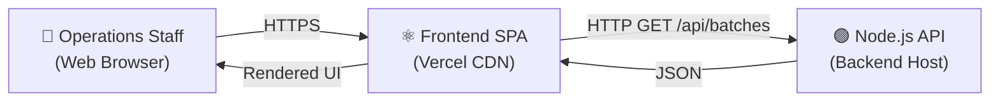

# System Documentation

## Batch Operations UI

**Prepared by:** Bharath Kumar Chaduvula
**Version:** 1.0
**Date:** 2026-11-05
**Document Status:** Final

---

## 1. System Overview

The **Batch Operations UI** is a full-stack web application that provides training operations staff with a centralised dashboard to monitor, search, and filter training batches across multiple centres.

The system is composed of:

- A **React SPA** (Single-Page Application) served from a CDN or static host.
- A **Node.js/Express REST API** providing batch data with filtering and pagination.
- An **in-memory data layer** (12 sample records) as the current persistence mechanism.

---

## 2. System Context



The system operates entirely over HTTP/HTTPS. No real-time (WebSocket) connections are used. All interactions are request-response cycles triggered by user actions.

---

## 3. System Components

### 3.1 Frontend SPA

| Property | Value |
|---|---|
| Technology | React 19 + Vite + Tailwind CSS 4 |
| Deployment | Vercel (CDN, global) |
| Entry Point | `index.html` → `main.jsx` → `App.jsx` |
| API Client | Axios (`batchService.js`) |
| Routing | None (single page) |

**Key Pages/Views:**
- **Batch Operations Page** — the only page in v1.0.

**Key Components:**

| Component | Purpose |
|---|---|
| `Sidebar` | Navigation and branding |
| `BatchOperationsPage` | State management and data orchestration |
| `FilterBar` | Search + filter controls |
| `BatchTable` | Data display with states |
| `PaginationFooter` | Page navigation |

### 3.2 Backend REST API

| Property | Value |
|---|---|
| Technology | Node.js LTS + Express 5 |
| Default Port | `5000` |
| Endpoints | `GET /`, `GET /api/batches` |
| Middleware | CORS, JSON body parser |
| Data Source | In-memory JavaScript array |

---

## 4. Data Flow

### 4.1 Nominal Flow

```
1. User opens the web application in a browser.
2. Browser loads the React SPA from the CDN (Vercel).
3. React mounts and BatchOperationsPage initialises.
4. useEffect triggers fetchBatches() on mount.
5. Axios sends GET /api/batches?page=1&limit=5 to the backend.
6. Express receives the request → routes to batchController.getBatches().
7. Controller validates params → filters batches[] → paginates → builds JSON.
8. Controller returns JSON response (200 OK).
9. Axios resolves → React sets batches and pagination state.
10. BatchTable renders table rows; PaginationFooter renders page controls.
```

### 4.2 Filter Flow

```
1. User changes search input / selects status or centre.
2. updateFilter() calls the filter setter + resets page to 1.
3. State change triggers useEffect re-run.
4. New API request with updated query params is sent.
5. Results update in the table.
```

### 4.3 Error Flow

```
1. API request fails (backend down, network issue).
2. .catch() sets error state with message.
3. BatchTable renders error message + Retry button.
4. User clicks Retry → retryKey incremented.
5. useEffect re-runs → new API request.
```

---

## 5. User Interface Guide

### 5.1 Layout Overview

```
┌─────────────────────────────────────────────────────────────────┐
│  SIDEBAR                │  MAIN CONTENT AREA                    │
│  ─────────────────────  │  ─────────────────────────────────    │
│  [B] Batchly            │  Workspace                            │
│      Operations         │  Batch Operations       [+ Create]    │
│                         │                                       │
│  Franchise Mgmt  ←active│  ┌─────────────────────────────────┐ │
│  Student Mgmt           │  │ 🔍 Search...  Status ▼  Centre ▼│ │
│  LMS                    │  └─────────────────────────────────┘ │
│  Finance                │                                       │
│  HRMS                   │  ┌─────────────────────────────────┐ │
│  Centers                │  │ Batch Code │ Course │ ... │ ...  │ │
│  ──────────             │  │ BAT-2026-001 │ Full Stack │ ...  │ │
│  Assets                 │  │ BAT-2026-002 │ ...        │ ...  │ │
│  Support                │  └─────────────────────────────────┘ │
│                         │                                       │
│  [Log Out]              │  Showing 1–5 of 12 Batches  [<][1][2][3][>] │
└─────────────────────────────────────────────────────────────────┘
```

### 5.2 Filter Bar Controls

| Control | Type | Action |
|---|---|---|
| Search box | Text input | Filters by batch code or course (live) |
| Status dropdown | Select | Filters by Running / Upcoming / Completed |
| Centre dropdown | Select | Filters by training centre city |
| Filter icon button | Button | Visual placeholder (not functional in v1.0) |

### 5.3 Batch Table States

| State | Trigger | Display |
|---|---|---|
| **Loading** | Request in flight | Orange spinning icon + "Loading batches..." |
| **Error** | API request failed | Error message (red) + "Retry" button (orange) |
| **Empty** | 0 results returned | "No batches match your search or filters" |
| **Populated** | 1+ results returned | Data rows with status badges |

### 5.4 Status Badge Guide

| Badge | Colour | Meaning |
|---|---|---|
| 🟢 Running | Green | Batch is currently in session |
| 🟡 Upcoming | Amber/Yellow | Batch is scheduled but not yet started |
| ⚫ Completed | Grey | Batch has finished |

---

## 6. Configuration Reference

### 6.1 Frontend Environment Variables

| Variable | Dev Default | Prod Value | Description |
|---|---|---|---|
| `VITE_API_BASE_URL` | `http://localhost:5000` | Your backend URL | Backend API base URL |

### 6.2 Backend Environment Variables

| Variable | Default | Description |
|---|---|---|
| `PORT` | `5000` | HTTP server port |

### 6.3 Frontend Build Output

After `npm run build`:

| File | Purpose |
|---|---|
| `dist/index.html` | HTML shell |
| `dist/assets/index-*.js` | Bundled JavaScript |
| `dist/assets/index-*.css` | Bundled CSS |

---

## 7. API Quick Reference

| Method | Path | Description |
|---|---|---|
| `GET` | `/` | Health check |
| `GET` | `/api/batches` | List batches (supports search, status, centre, page, limit) |

### Request Example

```
GET /api/batches?page=1&limit=5&search=python&status=Running&centre=Pune
```

### Response

```json
{
  "success": true,
  "data": [ ...batch objects ],
  "pagination": {
    "page": 1,
    "limit": 5,
    "totalRecords": 1,
    "totalPages": 1
  }
}
```

---

## 8. Known Limitations

| # | Limitation | Impact | Planned Fix |
|---|---|---|---|
| 1 | In-memory data only | Data lost on restart | Database in Phase 2 |
| 2 | No authentication | Open API access | Auth in Phase 2 |
| 3 | No batch CRUD | Cannot create/edit/delete | CRUD in Phase 2 |
| 4 | Static centre list | Frontend hard-coded | `/api/centres` endpoint |
| 5 | No tests | Manual testing only | Vitest + Supertest |
| 6 | Open CORS | All origins allowed | Restrict in production |
| 7 | Desktop-first sidebar | Mobile layout limited | Collapsible nav |

---

## 9. Document Index

All project documentation is stored in the `project/docs/` directory:

| Document | File | Description |
|---|---|---|
| Project Proposal | `project-proposal.md` | Goals, scope, timeline, deliverables |
| BRD | `business-requirements-document.md` | Business objectives and requirements |
| SRS | `software-requirements-specification.md` | As-built system specification |
| FRS | `functional-requirements-specification.md` | Detailed functional requirements and use cases |
| HLD | `high-level-design.md` | System architecture and technology stack |
| LLD | `low-level-design.md` | Module-level design, algorithms, state diagrams |
| Project Plan | `project-plan.md` | WBS, schedule, milestones, risks |
| Source Code Doc | `source-code-documentation.md` | Per-file reference for all source files |
| Technical Doc | `technical-documentation.md` | Dev setup, conventions, build process |
| API Documentation | `api-documentation.md` | REST API reference with examples |
| Deployment Document | `deployment-document.md` | Step-by-step deployment guide |
| System Documentation | `system-documentation.md` | This document — system overview and reference |

---

## 10. Support and Maintenance

### Common Issues and Fixes

| Symptom | Diagnosis | Fix |
|---|---|---|
| White/blank page | Build issue or wrong deploy path | Check `dist/` output; verify Vercel output dir |
| "Unable to load batches" | Backend unreachable | Start backend; check `VITE_API_BASE_URL` |
| Filters not updating | Stale state or JS error | Check browser console; ensure React version matches |
| `cors` error in console | CORS misconfigured | Verify `cors()` is added in `app.js` before routes |
| Port conflict | Port 5000 in use | Set `PORT=5001` env var for backend |

### Developer Contacts

| Role | Name |
|---|---|
| Developer / Author | Bharath Kumar Chaduvula |

---

*This document is prepared for educational and assignment purposes.*

